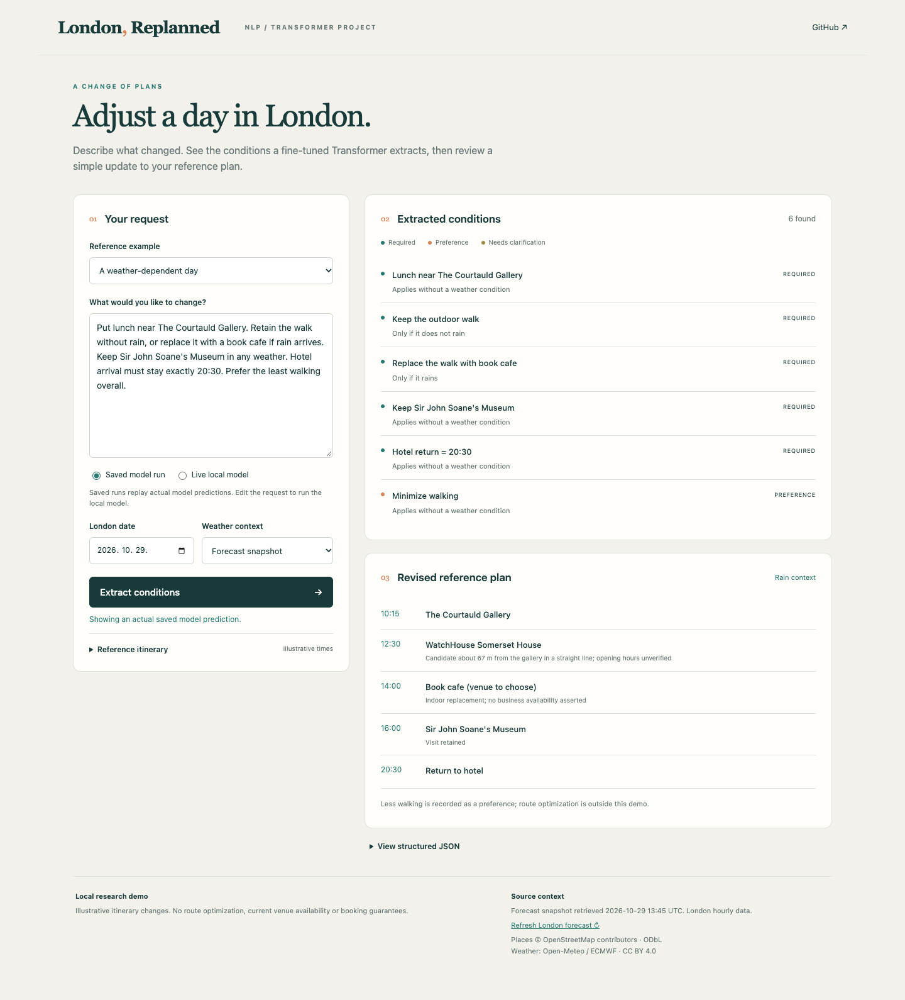

# Travel Constraint Extraction

A locally fine-tuned Transformer that turns English requests to change a London itinerary into structured JSON. It extracts place visits, time bounds, walking limits, and weather conditions. A browser demo shows how the extracted conditions change an example plan.

## Results

The earlier and improved adapters use the same Qwen2.5-1.5B-Instruct base. Both were tested on the same **100 held-out requests**. Both full systems used the same validation and retry rules.

| Output scored | Earlier F1 | Improved F1 | Earlier exact match | Improved exact match |
| --- | ---: | ---: | ---: | ---: |
| Primary model only | 0.506 | **0.833** | 44/100 | **75/100** |
| Full system | 0.754 | **0.902** | 61/100 | **82/100** |

F1 measures extracted constraint content. Exact match requires every constraint, priority, and clarification flag in the request to match. The [frozen outputs and protocol](experiments/final100/) allow the scores to be checked without generating predictions again.

The dataset has **1,000 synthetic requests** (800 training, 100 validation, 100 test). The expanded run continued the earlier LoRA adapter for 1,600 updates. Requests and target answers were AI-authored and received no human review. The results do not establish performance on real traveler requests. See the [experiment guide](experiments/README.md) for the separate original 80-request baseline study and a remaining error.

## Run the demo



For saved examples and metric checks, install only the schema validator:

```sh
python3 -m venv .venv
.venv/bin/python -m pip install jsonschema==4.26.0
.venv/bin/python demo/app.py
```

Open <http://127.0.0.1:8765>. Saved mode replays recorded validation outputs without downloading model weights. To check the final scores:

```sh
.venv/bin/python experiments/final100/recompute.py
```

For new requests on Apple Silicon, install the pinned MLX dependencies and configure the included adapters:

```sh
.venv/bin/python -m pip install -r requirements.txt
.venv/bin/python configure_live.py
.venv/bin/python demo/app.py
```

Choose **Live local model** for new text. Setup downloads the pinned base models; the repository ships only the LoRA adapters. The demo illustrates edits and does not verify travel routes, walking times, opening hours, or bookings.

## Project layout

| Path | What to inspect |
| --- | --- |
| [src/travel_constraints/](src/travel_constraints/) | Output schema, model inference, evidence checks, and scoring |
| [data/expanded/](data/expanded/) | Frozen corpus, training examples, split IDs, and audit |
| [experiments/final100/](experiments/final100/) | Pinned settings, recorded predictions, metrics, and score reproduction |
| [artifacts/](artifacts/) | Earlier and improved 1.5B adapters, plus the 0.5B fallback |
| [demo/](demo/) | Local web interface and saved validation examples |
| [tests/](tests/) | Checks for the data, schema, scoring, and demo behavior |

**Stack:** Python, Qwen2.5, LoRA, MLX, JSON Schema, HTML, CSS, and JavaScript. The demo uses attributed OpenStreetMap locations and an Open-Meteo / ECMWF forecast snapshot.

**Hyojin Lee · Recent Areas of AI · 2026.** Codex assisted with code, synthetic data, experiments, and documentation. See [license scope](LICENSE_SCOPE.md) and [third-party notices](THIRD_PARTY_NOTICES.md).
