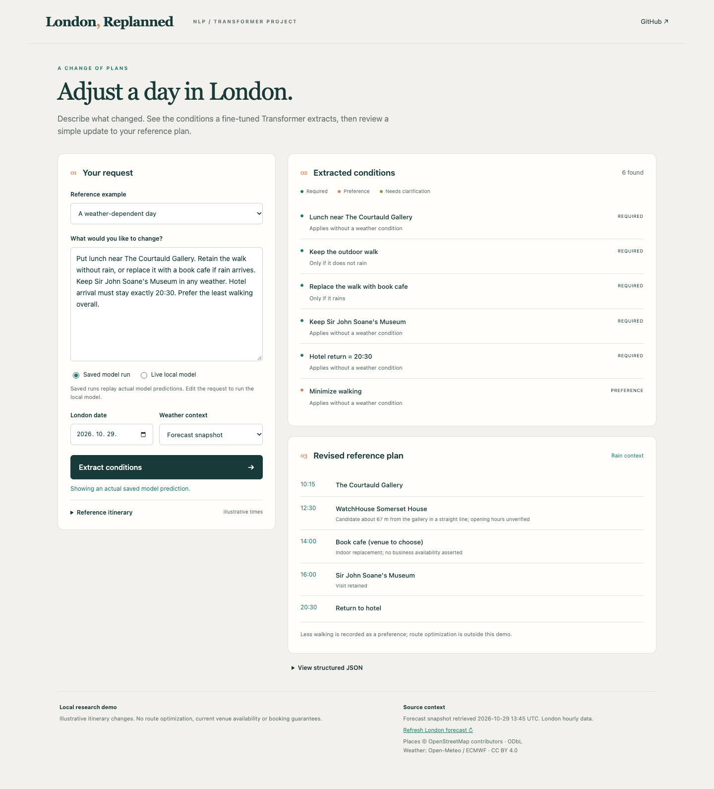

# Travel Constraint Extraction

**Fine-tune a small Transformer to extract structured conditions from English requests to change a London itinerary.**

The completed project includes a 400-record synthetic corpus, a trained LoRA adapter, a frozen three-model comparison, raw predictions and error analysis, and a local demonstration with weather-dependent plan edits.



## Task

Input: a short reference itinerary and a change request such as “Keep the gallery, return by 19:00, and reduce walking.” Output: JSON constraints recording the requested place, time operator and value, hard/soft priority, clarification needs, and any rain/dry condition. Relative phrases resolve against the reference itinerary. Missing information stays unresolved instead of receiving an invented value.

The **NLP model performs extraction**. A strict JSON/schema validator checks the output. A small deterministic planner then demonstrates how those conditions affect an itinerary. Weather and map data support that demonstration; route optimization is outside scope.

## Held-out results

| Approach | Content F1 | Fully correct records | Valid JSON | Mean generation seconds |
| --- | ---: | ---: | ---: | ---: |
| 0.5B baseline, zero-shot | 0.000 | 0/80 | 0.0% | 19.42 |
| 0.5B + LoRA, zero-shot | 0.795 | 57/80 | 97.5% | 3.93 |
| 7B 4-bit, two-shot | 0.782 | 51/80 | 93.8% | 30.01 |

Same **80 inputs from 20 reference groups**, temperature 0, seed 42, 768-token generation limit, strict schema, and no response repair. Content F1 matches constraint content; exact records additionally require all priorities and clarification flags. Invalid outputs count as empty extraction, so schema compliance can strongly affect F1. Priority accuracy must be read with recall because it is computed only on matched constraints.

**These are AI-reviewed synthetic labels, with zero human-verified records.** The corpus contains 100 scenarios × four paraphrases, split 280/40/80 by scenario. There are 400 unique full inputs and 252 distinct request texts; no identical request text crosses splits, but intents and wording patterns repeat. This is a controlled extraction experiment, not a real-user benchmark.

The 7B model differs in capacity, 4-bit quantization, and two-shot prompting. Generation timing includes prompt processing and the first request after load; model loading is separate. These measurements do not isolate model size or establish general inference-speed rankings. See the [frozen protocol](experiments/protocol.json), [full metrics and bootstrap intervals](experiments/results/comparison.json), and [actual errors](experiments/results/error_analysis.json).

## Run the demonstration

Saved validation predictions work with standard Python and no downloaded language model:

```bash
python3 demo/app.py
```

Open <http://127.0.0.1:8765>. Saved examples are actual model outputs, clearly labeled and separate from the held-out test. Changing the text selects live mode. Rain/dry controls are labeled simulations; forecast mode uses a timestamped Open-Meteo / ECMWF snapshot and supports refreshing it.

For **live model inference on Apple Silicon**:

```bash
python3 -m venv .venv
.venv/bin/python -m pip install -r requirements.txt
PYTHONPATH=src .venv/bin/python -m travel_constraints.download_models small
.venv/bin/python demo/app.py
```

The published adapter is loaded from `artifacts/qwen05_lora/`. No paid LLM API is required. See the [demo guide](demo/README.md). The first request loads the base model; model predictions can be wrong, and schema errors are displayed without correction.

## Training and reproducibility

Tested on **Apple M2, 16 GB unified memory, macOS 26.5.2, Python 3.13.7**, with pinned MLX dependencies in `requirements.txt`.

- Small model: `Qwen/Qwen2.5-0.5B-Instruct`, revision `7ae557604adf67be50417f59c2c2f167def9a775`, bfloat16.
- Large comparison: `mlx-community/Qwen2.5-7B-Instruct-4bit`, revision `c26a38f6a37d0a51b4e9a1eb3026530fa35d9fed`.
- LoRA: last four layers, rank 8, scale 20, 733,184 trainable parameters; Adam, learning rate 0.0001, batch 1, seed 42, 840 steps (three epochs), prompt loss masked, sequence cap 1,024.
- Final training completed on CPU after a failed GPU attempt. Failed weights were not reused. The trainer reported 6,008.016 seconds; all 56 saved adapter tensors were reloaded and matched exactly. Validation pool: 40 records, two batches sampled per loss check.
- Dataset and schema hashes, split IDs, training settings, model revisions, and inference provenance are retained. There was one completed training seed; no test-driven prompt or label changes.

Evaluate new runs separately without overwriting the submitted results:

```bash
PYTHONPATH=src .venv/bin/python -m travel_constraints.download_models all
PYTHONPATH=src .venv/bin/python experiments/run_comparison.py --output outputs/reproduction/results --runtime outputs/reproduction/runtime
```

This uses the published adapter when the original local training directory is absent. The frozen protocol preserves the original path as provenance. The runner refuses partial files rather than silently replacing them. Exact numerical reproduction can vary with runtime and hardware.

Recompute a submitted model's aggregate scores without inference:

```bash
PYTHONPATH=src .venv/bin/python -m travel_constraints.metrics --records data/travel_requests.jsonl --predictions experiments/results/small_lora.jsonl --split test --output outputs/recomputed_lora_metrics.json
PYTHONPATH=src .venv/bin/python -m unittest discover -s tests -v
```

The data builder and training launcher are retained for inspection. Their historical `final` training gate requires human-reviewed annotations; this experiment keeps all human-review flags false and records its full synthetic training run separately. Releasing the adapter does not imply that this gate was bypassed or that labels were human approved.

## London sources and boundaries

Six reference locations come from **© OpenStreetMap contributors**, ODbL, with source/snapshot metadata. A nearby cafe candidate uses straight-line distance, not a walking route. Opening hours and availability are unverified; book cafe is a requested category until a venue is selected.

Forecasts are **Open-Meteo / ECMWF, CC BY 4.0**, using ECMWF IFS 0.25°. Rain/showers are preceding-hour totals: 14:00–15:00 uses the bucket ending at 15:00. The 0.1 mm/hour threshold is an application choice. Missing coverage stays unknown. The demo does not guarantee a feasible itinerary, walking cap, or booking.

## Project files

| Path | Contents |
| --- | --- |
| `data/` | Frozen 400-record corpus, splits, review provenance, London source snapshots |
| `src/travel_constraints/` | Contract, generation/audit, training, inference, metrics, weather, planner |
| `artifacts/qwen05_lora/` | Trained adapter, model card, Apache license and modification notice |
| `experiments/` | Frozen protocol, training provenance, raw predictions, scores, errors |
| `demo/` | Local interface, actual validation predictions, run guide |
| `docs/` | Seven-page report, six-slide deck, speaking notes, Korean explanation, screenshots |
| `tests/` | Dataset/metric/schema/weather/planner behavior checks |

## Submission and authorship

[Report](docs/travel_constraint_report.pdf) · [Slides (PPTX)](docs/travel_constraint_presentation.pptx) · [Slides (PDF)](docs/travel_constraint_presentation.pdf) · [Korean explanation](docs/understanding_ko.md)

Hyojin Lee · Recent Areas of AI · 2026. Codex assisted with implementation, synthetic labels, consistency checks, experiment execution, and documentation. Human annotation review is not claimed. The report describes this assistance and the experiment's limits.

## Licenses and sources

The Qwen base models use Apache 2.0; the redistributed adapter preserves its [license and modification notice](artifacts/qwen05_lora/NOTICE). Original project materials have no additional blanket reuse license; see [LICENSE_SCOPE.md](LICENSE_SCOPE.md). Third-party data retains its own terms; see [THIRD_PARTY_NOTICES.md](THIRD_PARTY_NOTICES.md).

Technical sources: [Qwen2.5 report](https://arxiv.org/abs/2412.15115), [LoRA paper](https://arxiv.org/abs/2106.09685), [Open-Meteo ECMWF documentation](https://open-meteo.com/en/docs/ecmwf-api), [OpenStreetMap copyright](https://www.openstreetmap.org/copyright).
